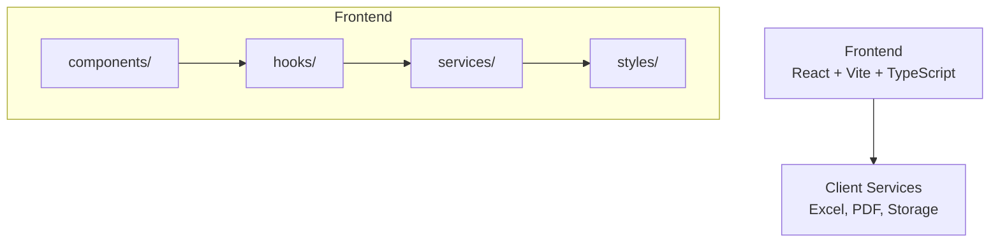
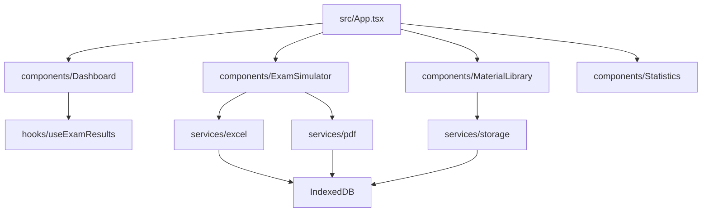

# PASAPP

_**PASAPP is a personal web application for studying and practicing exam questions for the PAS (Insurance Advisor) course in Argentina.__

The app allows users to study insurance exam material, import questions and documents, run exam simulations, and track their progress.

&nbsp;&nbsp;&nbsp;&nbsp;


&nbsp;&nbsp;&nbsp;&nbsp;
[](https://github.com/ismaelmarot/PASAPP/blob/HEAD/LICENSE)
&nbsp;&nbsp;&nbsp;&nbsp;


### Frontend Stack


&nbsp;&nbsp;&nbsp;&nbsp;


<br>

------------------------------------------------------------------------------------

## What It Does?

- **Study materials library**: Laws (PDFs), notes (PDFs) and exam questions (Excel) provided in `/public/data/`
- **Excel import**: Load exam questions from Excel files with SheetJS
- **PDF processing**: Extract text from PDF documents with PDF.js
- **Exam simulator**: Run exams with imported questions and complementary study documents
- **Dashboard**: Overview of study activity and progress
- **Statistics**: Track exam results and performance

&nbsp;&nbsp;&nbsp;&nbsp;

------------------------------------------------------------------------------------

## 🛠️ INFRASTRUCTURE & SERVICES

| Service | Badge | Description |
|---------|-------|-------------|
| **Frontend** |  | Static React frontend hosting with global CDN and automatic SSL |
| **Storage** |  | Local browser persistence with IndexedDB, no sync between devices |

&nbsp;&nbsp;&nbsp;&nbsp;

------------------------------------------------------------------------------------

## 📑 [TABLE OF CONTENT](#-table-of-content)

1. [Highlights](#highlights)
2. [Core Features](#core-features)
3. [Technologies Stack](#technologies-stack)
4. [Codebase Layer Map](#codebase-layer-map)
5. [Installation](#installation)
6. [Usage](#usage)
7. [Project Structure](#project-structure)
8. [Key Module Relationships](#key-module-relationships)
9. [Storage](#storage)
10. [Screenshots](#screenshots)
11. [Live Demo](#live-demo)
12. [Versions](#versions)

&nbsp;&nbsp;&nbsp;&nbsp;

------------------------------------------------------------------------------------

<a id="highlights"></a>
## 🌟 [HIGHLIGHTS](#-table-of-content)

- Personal study web app with React frontend and client-side services
- IndexedDB database for local persistence
- Responsive study-focused design
- Client-side document processing (Excel + PDF)
- Modular architecture with reusable components
- Fully typed with TypeScript
- Styled-components for CSS-in-JS
- Static build, no backend required, deployable to static hosting
- Vitest + ESLint for testing and code quality

&nbsp;&nbsp;&nbsp;&nbsp;

------------------------------------------------------------------------------------

<a id="core-features"></a>
## ✨ [CORE FEATURES](#-table-of-content)

| Feature              | Description |
|---------------------|-------------|
| Material library    | Study laws (PDFs), notes (PDFs) and questions (Excel) from `/public/data/` |
| Excel import        | Import exam questions from Excel files (SheetJS) |
| PDF processing      | Extract text from PDF documents (PDF.js) |
| Exam simulator      | Simulate exams using imported questions and complementary documents |
| Dashboard           | Overview of study activity |
| Statistics          | Track exam results and performance |

&nbsp;&nbsp;&nbsp;&nbsp;

------------------------------------------------------------------------------------

<a id="technologies-stack"></a>
## 🛠️ [TECHNOLOGIES STACK](#-table-of-content)

| Category            | Library / Tool     | Version |
|---------------------|--------------------|---------|
| Frontend UI         | React              | ^18.3.1 |
| Frontend Language   | TypeScript         | ~5.6.3  |
| Frontend Build      | Vite               | ^6.0.5  |
| Frontend Styling    | styled-components  | ^6.1.15 |
| Document Parsing    | SheetJS (xlsx)     | ^0.18.5 |
| Document Parsing    | PDF.js             | ^4.7.75 |
| Database            | IndexedDB          | -       |
| Testing             | Vitest             | ^3.0.5  |
| Code Quality       | ESLint             | ^9.17.0 |

&nbsp;&nbsp;&nbsp;&nbsp;

------------------------------------------------------------------------------------

<a id="codebase-layer-map"></a>
## 🔄 [CODEBASE LAYER MAP](#-table-of-content)



&nbsp;&nbsp;&nbsp;&nbsp;

------------------------------------------------------------------------------------

<a id="installation"></a>
## 🚀 [INSTALLATION](#-table-of-content)

### Prerequisites

- Node.js >= 18
- npm or yarn

### 1. Clone the repository

```bash
git clone https://github.com/ismaelmarot/PASAPP.git
cd PASAPP
```

### 2. Install dependencies

```bash
npm install
```

### 3. Run development server

```bash
npm run dev
```

### 4. Access the app

- Frontend: http://localhost:5173

&nbsp;&nbsp;&nbsp;&nbsp;

------------------------------------------------------------------------------------

<a id="usage"></a>
## ⚙️ [USAGE](#-table-of-content)

### User Flow

| Step | Description |
| ---- | ----------- |
| 1    | Place study materials (PDFs and Excel) in `/public/data/` |
| 2    | Import questions and documents |
| 3    | Browse the material library |
| 4    | Run the exam simulator |
| 5    | Review results and statistics |

&nbsp;&nbsp;&nbsp;&nbsp;

------------------------------------------------------------------------------------

<a id="project-structure"></a>
## 📂 [PROJECT STRUCTURE](#-table-of-content)

```
PASAPP
├── public/
│   └── data/
│       ├── laws/        # PDFs of laws and legislation
│       ├── notes/       # PDFs of notes and study material
│       └── questions/   # Excel file with exam questions
│
├── specs/
│
├── src/
│   ├── components/
│   ├── hooks/
│   ├── services/
│   ├── interfaces/
│   ├── constants/
│   ├── styles/
│   ├── utils/
│   └── test/
│
├── index.html
├── package.json
└── README.md
```

&nbsp;&nbsp;&nbsp;&nbsp;

------------------------------------------------------------------------------------

<a id="key-module-relationships"></a>
## 📂 [KEY MODULE RELATIONSHIPS](#-table-of-content)



&nbsp;&nbsp;&nbsp;&nbsp;

------------------------------------------------------------------------------------

## 💾 [STORAGE](#-table-of-content)

The app persists data in the browser's IndexedDB. Data is not synchronized between devices.

&nbsp;&nbsp;&nbsp;&nbsp;

------------------------------------------------------------------------------------

## 📸 [SCREENSHOTS](#-table-of-content)

> Screenshots coming soon.

&nbsp;&nbsp;&nbsp;&nbsp;

------------------------------------------------------------------------------------

## 🌍 [LIVE DEMO](#-table-of-content)

The app is a static web application, so deployment is just a static hosting upload.

&nbsp;&nbsp;&nbsp;&nbsp;

------------------------------------------------------------------------------------

## 📌 [VERSIONS](#-table-of-content)

| Version | Date | Changes |
|---------|------|---------|
| 0.1.0 | - | Initial release - Study app with material library, Excel/PDF import and exam simulator |

&nbsp;&nbsp;&nbsp;&nbsp;

------------------------------------------------------------------------------------

## 🔒 [SECURITY](#-table-of-content)

- **Local Storage**: All user data is stored in the browser's IndexedDB, no data leaves the device
- **No Backend**: No API keys, database URLs or credentials required
- **No Hardcoded Secrets**: The codebase contains no credentials
- **Client-side Processing**: Documents are processed locally in the browser

### For Production Deployment

1. Build the static site: `npm run build`
2. Deploy the `dist/` folder to static hosting (Vercel, Netlify, GitHub Pages)
3. Use HTTPS for all communications

&nbsp;&nbsp;&nbsp;&nbsp;

------------------------------------------------------------------------------------

## 📄 [LICENSE](#-table-of-content)

This project is licensed under the MIT License - see the [LICENSE](https://github.com/ismaelmarot/PASAPP/blob/HEAD/LICENSE) file for details.

&nbsp;&nbsp;&nbsp;&nbsp;

------------------------------------------------------------------------------------

## 📬 [CONTACT](#-table-of-content)

Open to collaboration, feedback, and new opportunities.

[](https://github.com/ismaelmarot)
[](https://linkedin.com/in/ismael-marot)
[](https://ismaelmarot.github.io)
